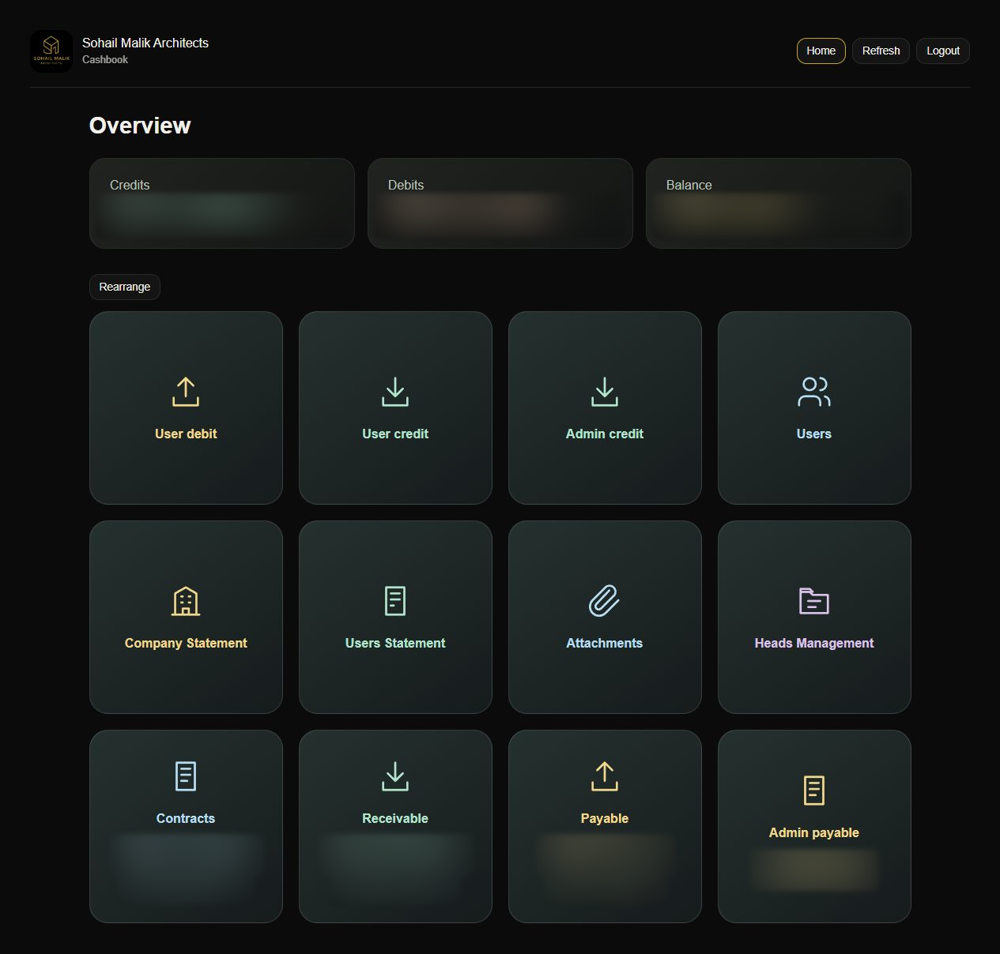
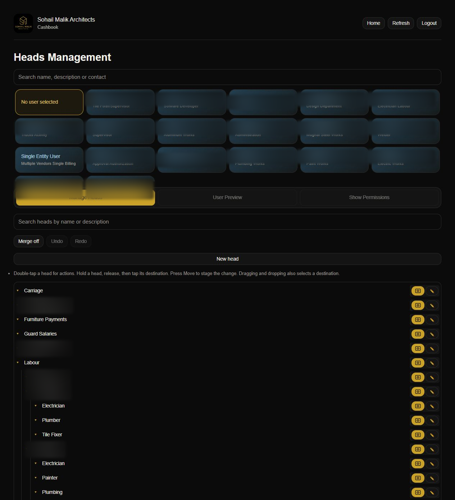
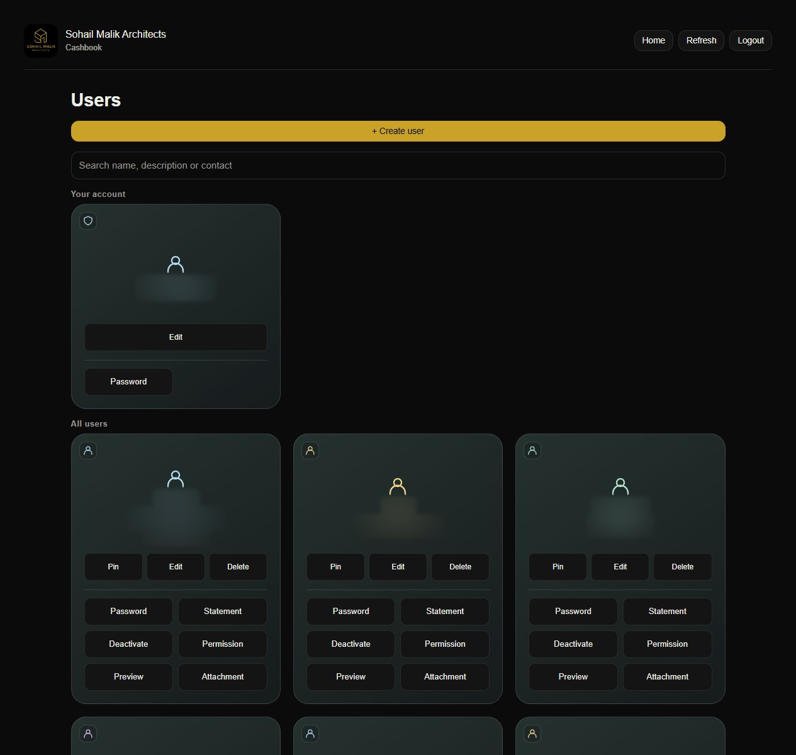
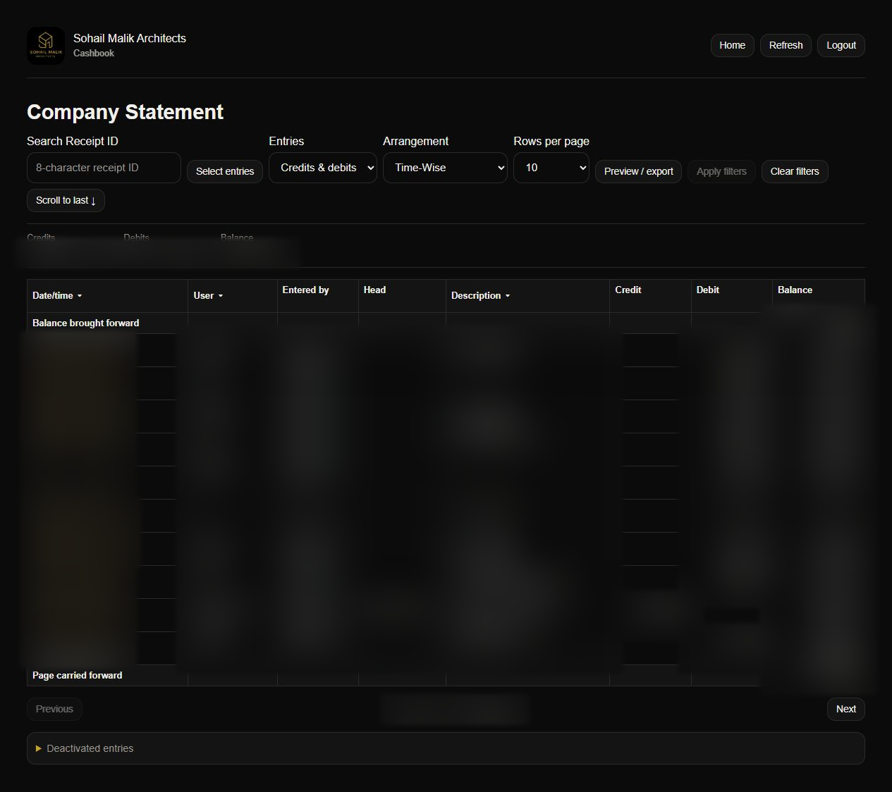
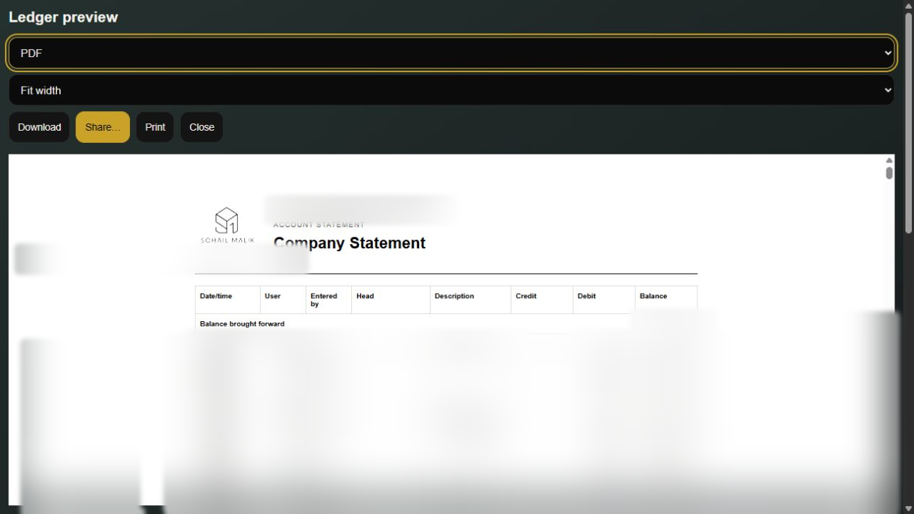
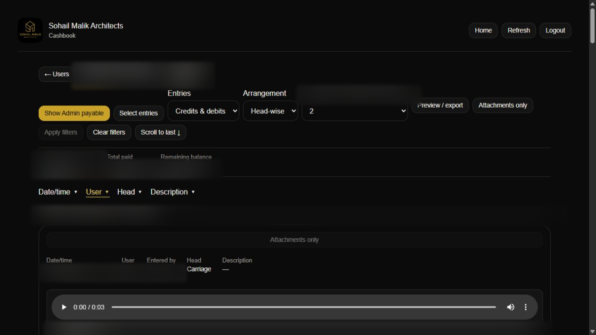
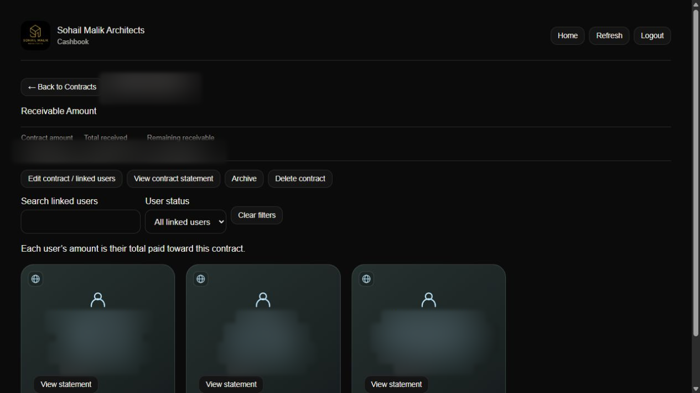
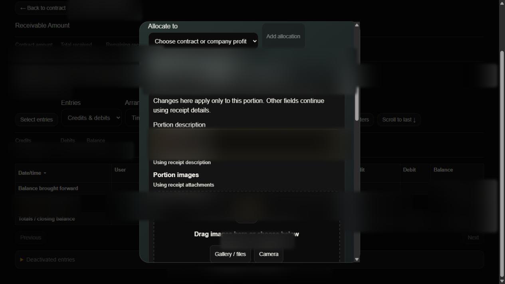

# Transaction Management System

A cashbook for company accounts, users, external receipts, and contracts—with images, voice notes, and printable statements. Built with React, FastAPI, and PostgreSQL, with a responsive interface for desktop and mobile.

## What it does

| Area | Features |
| --- | --- |
| Home | Balance overview, rearrangeable action cards, and pinned accounts. |
| Users & access | Normal and external users, profiles, multiple contacts, account status, passwords, head permissions, and a safe user preview. |
| Head management | Nested heads, search, transaction permissions, staged edits/moves/merges, backups, and undo/redo before Apply. |
| Entry workflows | User debit for payments, User credit for bills recorded on a user’s behalf, and Admin credit for external receipts. Images, voice, description, and review steps keep evidence with entries. |
| Statements | Company and user statements; date/time, user, head/contract, and description filters; credit/debit views, ordering, carry-forward balances, and scroll to last. |
| Selection & reports | Select individual entries or ranges, unselect them, preview, print, export PDF/Excel/CSV, share supported files, or export attachments only. |
| Attachments | Camera/gallery/file uploads, voice recording and audio uploads, head-wise browsing, image previews, and image-only PDFs. |
| Contracts & receipts | Shared contracts linked to external users, individual contributions, contract/profit/direct receipt portions, Receipt ID search, and field-by-field inheritance of descriptions, images, and voice notes. |
| Outstanding balances | Receivable and Payable include contract balances; overpaid contracts move to Payable and zero balances are excluded. |
| Admin payable | Personal obligations remain separate from company cash; payments appear in Company Statement. User statements can show or hide these entries. |
| History | Versioned edits and retained evidence, deactivated-entry review, and checks against saving stale changes. |

## Production screenshots

Amounts and private details are heavily blurred. These are captures of the live application, not mockups. Click an image to inspect it.

<table>
<tr>
<td width="50%"><strong>Home dashboard</strong> </td>
<td width="50%"><strong>Head management</strong> </td>
</tr>
<tr>
<td><strong>User management</strong> </td>
<td><strong>Company Statement</strong> </td>
</tr>
<tr>
<td><strong>Preview & export</strong> </td>
<td><strong>Attachment browsing</strong> </td>
</tr>
<tr>
<td><strong>Contracts & linked users</strong> </td>
<td><strong>Details for each receipt portion</strong> </td>
</tr>
</table>

## Run, test & maintain

Start with the [development guide](docs/DEVELOPMENT.md) for local setup and commands. See the [backend API guide](backend/README.md), [database notes](database/README.md), and [production deployment guide](deploy/README.md) for implementation and operations.

GitHub Actions runs frontend, backend, database, and desktop/mobile browser checks before deployment. Production uses HTTPS and private attachment storage. Keep credentials out of Git and back up the database together with its media.
